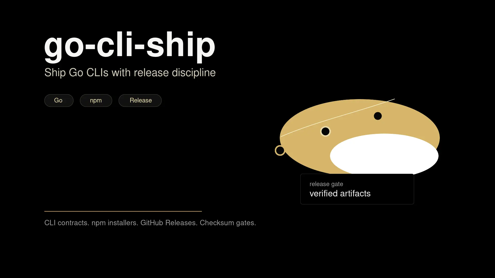

# go-cli-ship

**Production-grade delivery workflow for Go CLI projects, packaged as an Agent Skill.**



[](./LICENSE)

`go-cli-ship` helps agents and developers turn a Go command-line tool into a reproducible product: stable CLI contracts, testable Go code, npm-based binary installation, GitHub Release automation, checksum verification, optional Agent Skill packaging, and release gates that catch drift before publishing.

## Install

```bash
npx skills add geekjourneyx/go-cli-ship
```

After installing the skill, ask your agent to use `go-cli-ship` when creating, hardening, or releasing a Go CLI.

## Quick Start

```text
Use go-cli-ship to scaffold a production Go CLI named acme-sync.

Requirements:
- support human output and --json output
- install through npm
- publish GitHub Release artifacts with SHA256SUMS
- include make release-check as the final quality gate
```

The skill will guide the work from command contract to release verification instead of only generating a folder tree.

## Why It Exists

Go CLIs often start clean and become fragile at release time. The hard parts are usually not the command parser; they are version consistency, npm wrapper behavior, artifact naming, checksums, CI parity, fresh-install smoke tests, and keeping bundled Agent Skill content out of source code.

`go-cli-ship` captures those release lessons as reusable instructions and templates so each CLI can ship with the same minimum standard.

## What You Get

- A production-oriented Go CLI project shape: `cmd/`, `internal/`, `e2e/`, `scripts/`, `.github/workflows/`, and optional bundled skills.
- CLI contract guidance for human output, `--json`, stable stderr diagnostics, exit codes, and noninteractive automation.
- npm distribution templates that download the matching GitHub Release binary and verify `SHA256SUMS`.
- GitHub Actions templates for CI, multi-platform release artifacts, npm smoke tests, and publish flow.
- Agent Skill packaging rules that keep `skills/` content-only and optionally expose safe `skills list/read` commands.
- A `release-check` template that blocks placeholder drift, version drift, missing files, bad package contents, and common release mistakes.

## Included Templates

```text
templates/
├── github/workflows/
│   ├── ci.yml
│   └── release.yml
├── go/internal/skillcontent/
│   ├── reader.go
│   ├── reader_test.go
│   └── source.go
├── npm/
│   ├── package.json
│   └── scripts/
│       ├── install.js
│       └── run.js
└── scripts/
    └── release-check.sh
```

The templates intentionally use placeholders. Replace them before running checks:

```bash
rg "__[A-Z0-9_]+__" .
node -c scripts/install.js
node -c scripts/run.js
bash -n scripts/release-check.sh
```

If the placeholder scan returns any result, the scaffold is not ready.

## Release Standard

For a generated or upgraded CLI, the expected final gate is:

```bash
make release-check
```

A complete gate should cover formatting, `go vet`, tests, linting, npm package contents, README install commands, version alignment, release workflow requirements, and fresh install behavior when distribution code changes.

Before pushing a release tag, confirm the version, npm package name, GitHub repository, `NPM_TOKEN`, release-check result, and fresh npm install smoke test.

## Skill Boundary

This repository is an Agent Skill and template pack, not a general Go framework.

Use it when you need a repeatable delivery path for a Go CLI. For generated CLIs that bundle Agent Skills, keep skill content separate from Go source files, generated binaries, changelog entries, and internal maintenance notes.

## License

[MIT](./LICENSE)

## Author

Maintained by [geekjourneyx](https://github.com/geekjourneyx).
